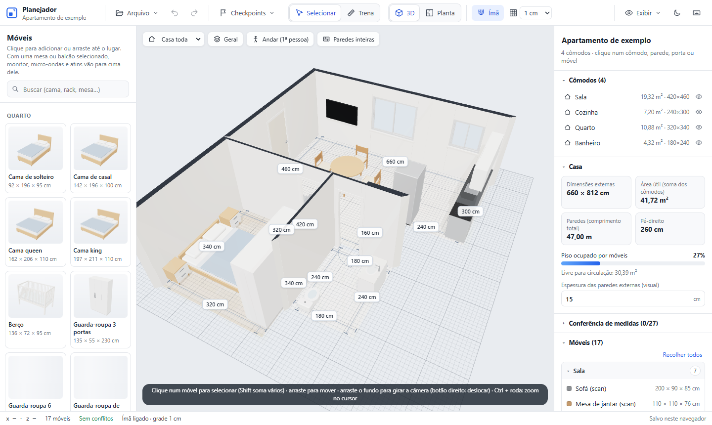

# Planejador de Cômodos

Planejador de móveis em 3D a partir dos scans do **Apple RoomPlan** (o LiDAR do iPhone), com medidas reais em centímetros. Junta scans de cômodos feitos separadamente numa casa só e deixa mobiliar, medir e comparar versões antes de comprar ou mandar fazer.

**[Abrir a demonstração](https://makenrosa.github.io/planejador-comodos/)**: um apartamento de exemplo. O que você mexer fica só no seu navegador.

<picture>
  <source media="(prefers-color-scheme: dark)" srcset="docs/imagens/vista-3d-escuro.png">
  
</picture>

## Destaques

- **Casa montada a partir de vários scans.** Cada scan vem num sistema de coordenadas próprio. O app encaixa os cômodos pelas portas em comum, calcula a espessura real das paredes compartilhadas e divide scans com mais de um ambiente ([src/lib/house.ts](src/lib/house.ts)).
- **3D, planta e primeira pessoa.** Ande pela casa com W A S D na altura dos olhos, sem atravessar paredes.
- **Móveis paramétricos.** Mudar a medida reconstrói o modelo (portas, gavetas, puxadores, assentos) em vez de esticar. Modelos `.glb` próprios também entram.
- **Precisão de obra.** Ímã em paredes e móveis, cotas editáveis, correção de parede pela trena e campos de medida que aceitam unidade e conta (`1,20 m`, `2x60`, `(250-12)/2`) com um parser próprio que nunca executa o texto ([src/lib/expr.ts](src/lib/expr.ts)).
- **Alertas.** Colisão, móvel atravessando parede, bloqueando porta ou janela. A colisão é pelas partes reais: a cadeira entra sob o tampo da mesa.
- **Versões.** Checkpoints com miniatura, desfazer ilimitado, vista atual na URL e sincronização entre abas.
- **Projeto em arquivos.** Com `npm run dev`, tudo é gravado em JSON com diff legível, para versionar com git.

A lista completa está em [docs/RECURSOS.md](docs/RECURSOS.md).

## English summary

A browser-based 3D furniture planner that imports Apple RoomPlan scans, joins rooms through shared doors, and supports parametric furniture and collision warnings. The public demo uses a fictional apartment. The static build saves changes in the browser; the local development server can persist projects as JSON files.

## Validação

A [CI](https://github.com/MakenRosa/planejador-comodos/actions/workflows/ci.yml) executa verificação de tipos, testes e build. Os [testes automatizados atuais](src/lib/house.test.ts) cobrem importação do RoomPlan e montagem dos cômodos com os dados de exemplo. Eles não substituem a conferência visual da interface 3D nem a validação das medidas de um imóvel real.

## Stack

React 19 · TypeScript (strict) · Three.js com React Three Fiber e drei · Zustand · Vite · Vitest

## Decisões técnicas

- **Sem backend.** Um plugin pequeno do Vite ([tools/casa-sync.ts](tools/casa-sync.ts)) grava o projeto em arquivos durante o desenvolvimento. O mesmo build roda como site estático, só com o armazenamento do navegador.
- **Geometria em funções puras.** Importação do RoomPlan, montagem da casa, colisões e encaixes ficam em [src/lib](src/lib), sem depender de React nem de Three.js. Os testes atuais exercitam a importação e a montagem com a casa de exemplo.
- **Móveis gerados por código** ([src/furniture](src/furniture)) em vez de modelos prontos: medidas brasileiras de verdade (camas, tomadas NBR 14136) e nenhum arquivo 3D pesado no repositório.
- **Arquivos amigáveis ao git.** JSON indentado com as coordenadas numa linha só, para `git diff` mostrar exatamente o que mudou (um móvel movido, uma cor trocada).

## Rodar

Precisa do [Node.js](https://nodejs.org) 20.19 ou mais novo.

```bash
npm install
npm run dev
```

Abra http://localhost:5173. Sem uma casa sua, abre o apartamento de exemplo de [public/rooms](public/rooms).

| Comando | O que faz |
| --- | --- |
| `npm test` | Testes (Vitest) |
| `npm run typecheck` | Verificação de tipos |
| `npm run build` | Build de produção em `dist/` |
| `npm run exemplo` | Regera a casa de exemplo ([tools/gerar-exemplo.mjs](tools/gerar-exemplo.mjs)) |

## Usar a sua casa

1. Escaneie os cômodos num iPhone ou iPad com LiDAR, num app que exporte o JSON do RoomPlan (`CapturedRoom`).
2. Coloque os `.json` em `casa/scans/`, com um `casa.json` dizendo quais portas ligam os cômodos. O formato está em [public/rooms/casa.json](public/rooms/casa.json): cada ligação aponta a porta de um cômodo e a do vizinho, pelo começo do id.
3. Rode `npm run dev`. O app abre a sua casa e grava tudo em `casa/`: `projeto.json`, `checkpoints.json` e `modelos/`.

A pasta `casa/` fica fora deste repositório (está no `.gitignore`). Ela pode ser um repositório git próprio e privado, para levar a casa de um PC para o outro sem publicar a planta:

```bash
cd casa
git init
git add .
git commit -m "Minha casa"
```

`CASA_DIR=/outro/caminho npm run dev` usa outra pasta. Abrir com `?semsync` na URL carrega a casa sem gravar nada.

## Estrutura

```
public/rooms/          casa de exemplo (scans fictícios no formato do RoomPlan)
tools/casa-sync.ts     plugin do Vite que lê e grava a pasta casa/
tools/gerar-exemplo.mjs  gera a casa de exemplo
src/
  lib/roomplan.ts      importador do JSON do RoomPlan
  lib/house.ts         montagem da casa a partir de vários scans
  lib/geom.ts          geometria 2D (SAT, polígonos, raios)
  lib/analysis.ts      colisões e alertas
  lib/solids.ts        partes sólidas dos móveis (cadeira sob a mesa)
  lib/expr.ts          unidades e contas nos campos de medida
  lib/wallEdit.ts      correção de paredes pela trena (reaplicada sobre o scan)
  lib/checks.ts        medidas conferidas com trena e encaixes justos
  lib/viewUrl.ts       vista atual na URL
  lib/casaSync.ts      lado do app da sincronização com a pasta casa/
  furniture/           modelos paramétricos e catálogo
  scene/               cena 3D (React Three Fiber)
  ui/                  painéis, barra de ferramentas, catálogo
  store.ts             estado (Zustand) com histórico
```

## Licença

[MIT](LICENSE)
